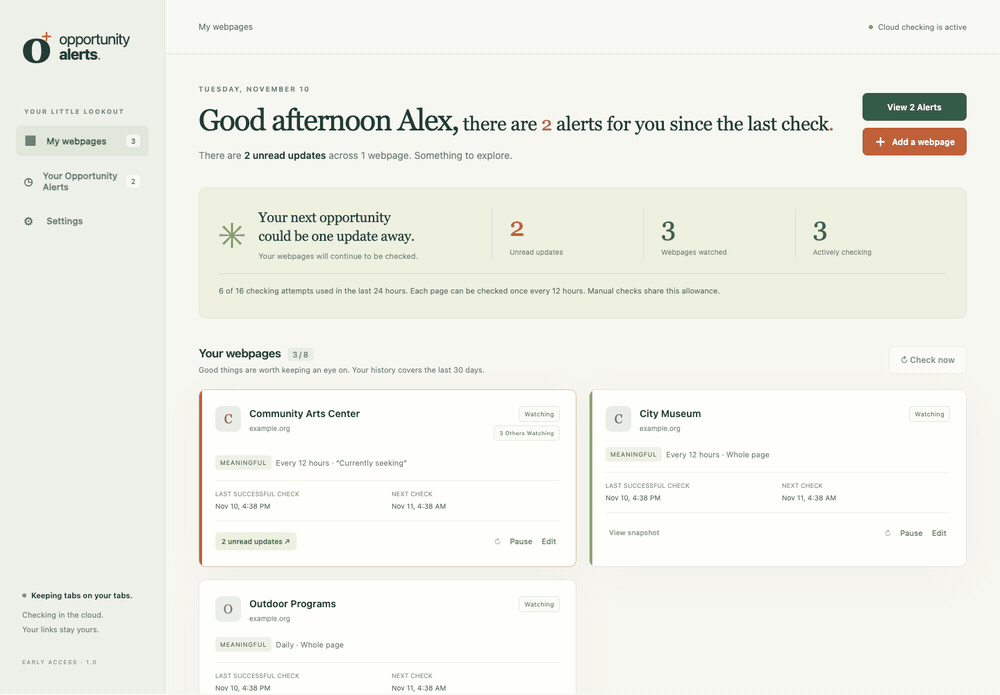
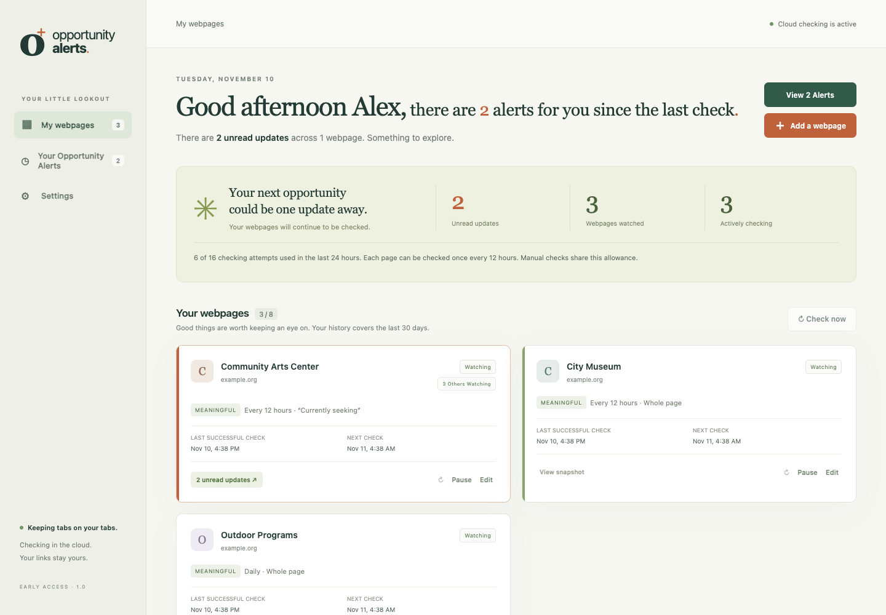
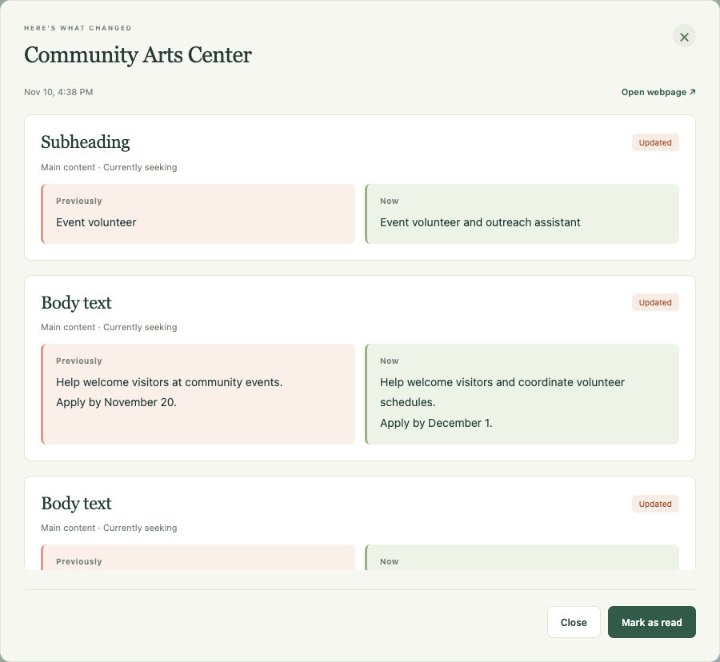
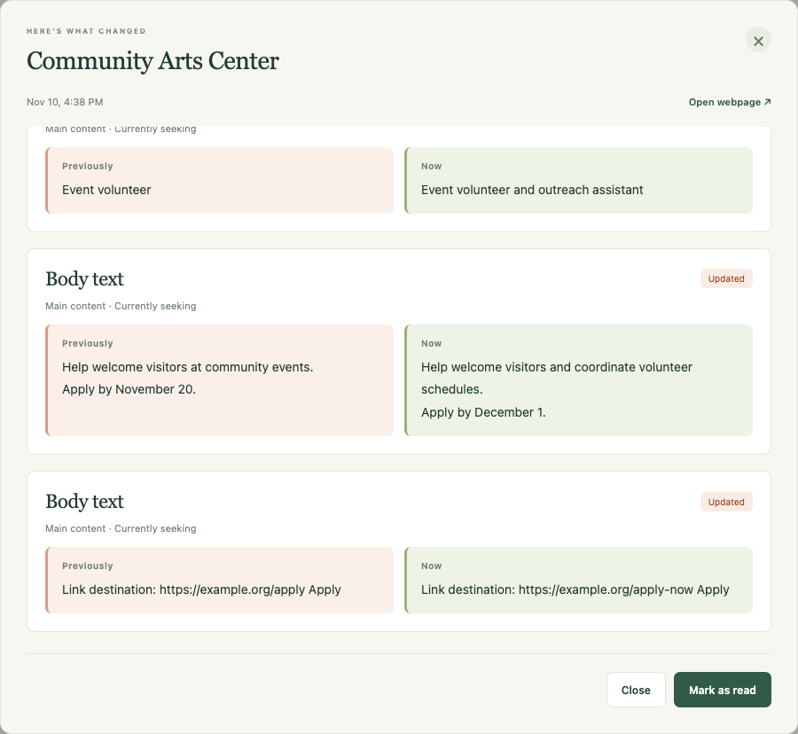
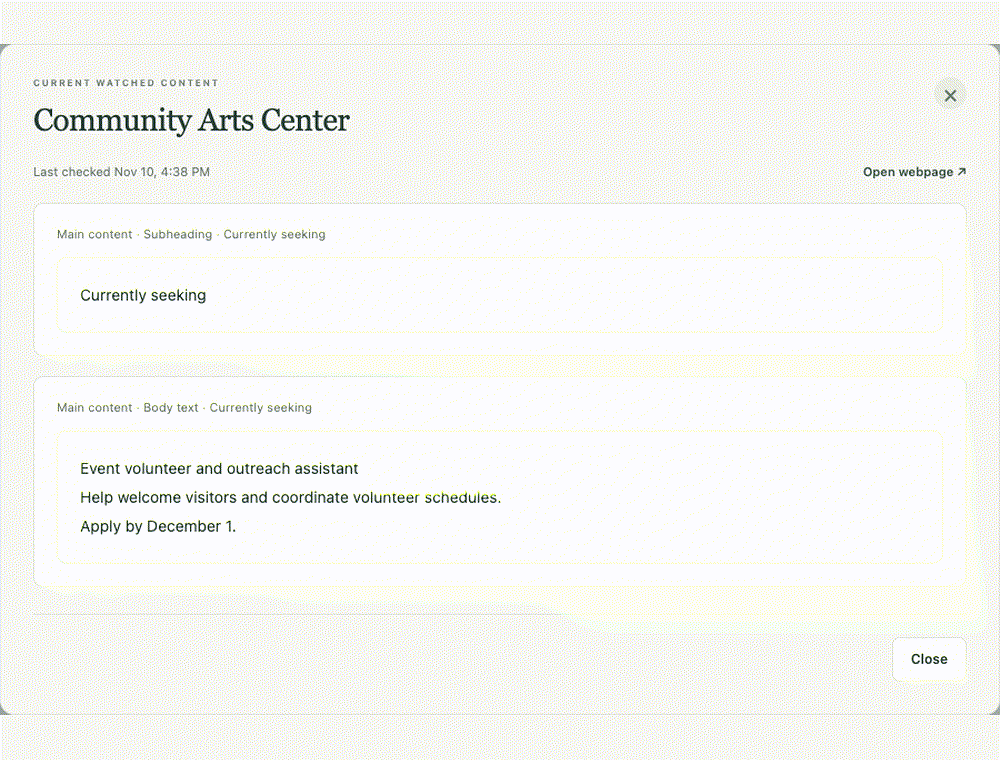
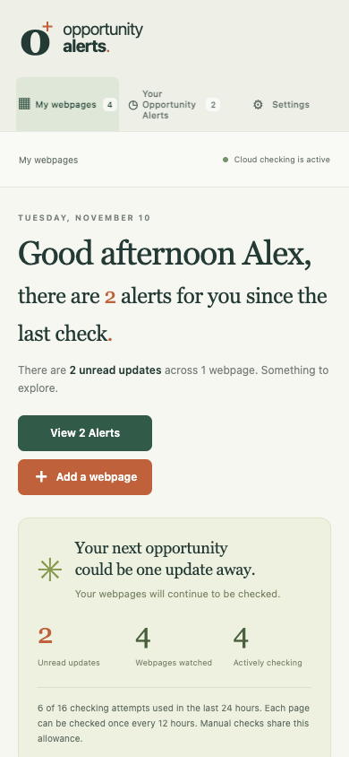
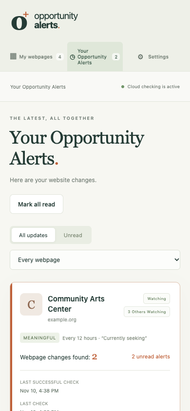
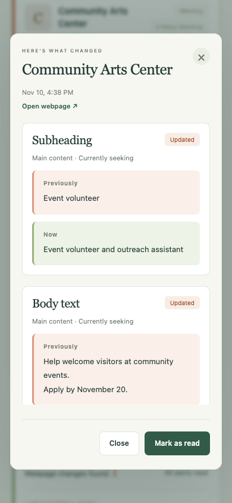

# Opportunity Alerts: Project Case Study

Opportunity Alerts is a hosted website that monitors public webpages for content changes and sends optional email alerts. It is in early access at [opportunityalerts.elichristmas.dev](https://opportunityalerts.elichristmas.dev).

<p align="center">
  
  <br />
  <sub>The actual interface with fictional sample pages and simulated changes.</sub>
</p>

## The problem

I was manually checking volunteer and job webpages, often revisiting the same links just to see whether a listing, deadline, description, or application link had changed. That takes time. It also makes finding an opportunity depend on remembering to open the right page at the right moment.

The same problem applies beyond job searches: community events, board openings, concerts, ticket announcements, and camping information can all appear on pages people do not have time to refresh repeatedly. I wanted a tool that would do the checking on a schedule and present the result in plain language. It needed to remain useful when the browser was closed and the computer was off.

## My role and scope

I defined the problem, product behavior, interface direction, privacy expectations, and early access limits. I guided implementation with AI coding assistance and reviewed the resulting behavior. The running product uses deterministic comparison rules; it does not use AI to decide whether a page changed or to write notification emails.

The first edition was a local Python service. It established the core checking and comparison behavior, but its checks stopped when the computer slept. The hosted edition moved scheduling, storage, checking, and email delivery to Cloudflare. Members use a website without installing software or supplying an API key.

## System design

| Part | Technology | Responsibility |
| --- | --- | --- |
| Browser interface | HTML, CSS, JavaScript | Responsive dashboard, watch controls, settings, and readable alert views |
| Application | Cloudflare Workers, TypeScript | Private account API, watch operations, quotas, scheduling, and notification coordination |
| Identity | Better Auth | Password sign-in, email verification, sessions, and password recovery |
| Storage | Cloudflare D1 | Accounts, watches, baselines, update history, checking attempts, and pending work |
| Page checker | Python, FastAPI, Beautiful Soup, curl_cffi in a private container | Fetching public HTML, extracting content, comparing snapshots, and identifying page structure |
| Background work | Cron Triggers and Queues | Finding due watches and processing checks after the browser is closed |
| Email | Cloudflare Email Service | Verification, recovery, test messages, and optional change notifications |

```text
Member saves a public webpage
    → Account API validates and stores the watch
    → Scheduled work finds it when due
    → Checking allowance is reserved
    → Private checker fetches and extracts page content
    → A valid snapshot is compared with the last valid snapshot
    → Detected changes are saved for the private dashboard
    → If enabled, a short email points the member to those changes
```

The scheduled path is separate from the browser. A dashboard refresh reads saved state; it does not spend a webpage check. The site can therefore report the last successful check, the next eligible check, and errors without depending on an open tab.

<p align="center">
  
  <br />
  <sub>Sample dashboard showing the information available for each watched page.</sub>
</p>

## Finding changes without creating noise

The first successful fetch becomes a baseline, so adding a watch does not generate a misleading “new” alert for everything already on the page. Later checks compare normalized snapshots. **Meaningful changes** focus on main content and link destinations; **All changes** also includes page text, navigation, footer content, and image references. A member can narrow either mode to a selected heading and its section.

The comparison intentionally includes small changes that matter: an edited date, a changed email address, different application wording, or a link whose visible text stayed the same while its destination changed. Whitespace and layout differences do not count. The product reports detected content updates, not a claim that it has identified a particular number of open opportunities.

The checker also saves available structure for display. The alert view can identify headings, body text, and page regions and show additions, removals, or **Previously / Now** values. Older updates without this structure still get readable generic labels.

<p align="center">
  
  <br />
  <sub>Example changes are shown as content a person can read, with fictional data.</sub>
</p>

<p align="center">
  
</p>

## Reliability decisions

**Failed requests preserve evidence.** If a website blocks a request, presents a challenge, times out, or removes a selected heading, the last valid snapshot remains in place. The dashboard shows an error. A failed fetch never becomes an empty snapshot that looks like every listing was removed.

**Changing what is watched resets the comparison.** Changing a URL, mode, or selected section starts a new baseline instead of comparing two different scopes and calling the difference an opportunity update. Section previews reuse content from a permitted fetch rather than requesting another check.

**Checking is bounded.** Early access allows 30 verified members, eight saved webpages per member, at least 12 hours between attempts on the same page, and 16 logical checking attempts per member in a rolling 24 hours. Initial checks, manual checks, and failed attempts use the same allowance. Allowances are reserved before work starts, so simultaneous requests cannot legitimately claim the same remaining slot. Queued work is checked against the current watch configuration before its result is accepted.

**Email follows saved updates.** Members opt in to change notifications. Updates detected close together are combined into a short email listing page names and a dashboard link; detailed source content stays behind sign-in. Pending delivery is recorded so temporary failures can be retried with limits, while an uncertain delivery is surfaced rather than resent indefinitely. Initial baselines and unchanged checks do not send change emails.

<p align="center">
  
  <br />
  <sub>Alert review with fictional sample changes.</sub>
</p>

## Security and privacy choices

The service accepts public HTML pages only and does not request credentials for the websites being watched. The checker validates destinations and redirects, blocks local and private network targets, and limits request time and response size. Fetched page content is treated as untrusted data; it is reduced to text and structural records rather than inserted as executable page HTML.

Members have separate accounts. Private operations check account ownership, and the site provides data export and account deletion. Service credentials and production configuration are kept out of the public documentation repository. No advertising trackers or third-party analytics SDKs are included. The service still has to process watched URLs and page content to monitor them; it is not end-to-end encrypted.

## How I checked the work

The private test suite exercises comparison modes, selected sections, changed link destinations, unchanged pages, failed fetches, and preservation of valid snapshots. Hosted tests cover authentication and ownership, concurrent checking limits, duplicate work, notification batching and retry states, and account deletion. Interface checks use isolated desktop and mobile browsers with fictional data, including a check that source-page text remains inert when displayed.

<p align="center">
  
  
  
</p>

These checks are evidence for the implementation, not an independent security audit or a guarantee that every site can be monitored. Some websites block automated access, depend on browser-side JavaScript, or require human verification. A scheduled alert also cannot promise that a job, campsite, or ticket will still be available when someone opens it.

## Where the project stands

The current release is a hosted website with private dashboards and optional email alerts. The public repository documents the product and shows sample interface captures. Application source and deployment configuration remain private. A native iOS client and paid membership are possible future directions, not features of this release.
