<p align="center">
  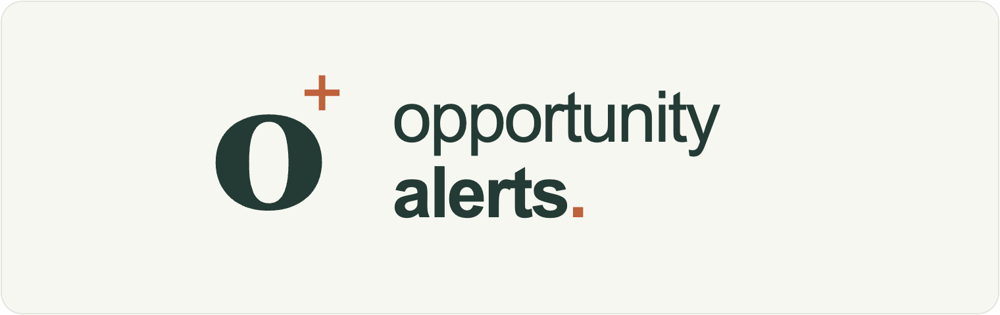
</p>

<p align="center"><strong>Keeping tabs on your tabs.</strong></p>

<p align="center">
  A website for keeping up with changes on the public webpages you care about. Save volunteer pages, job listings, community opportunities, event announcements, or other webpages, choose what to watch, and receive email updates when their content changes. Scheduled checks continue when your browser is closed and your computer is off. No downloads, local helper, user-supplied API keys, or AI change detection required.
</p>

<p align="center">
  
  
  
  
  
  
</p>

<p align="center">
  <a href="https://opportunityalerts.elichristmas.dev"><strong>Open Opportunity Alerts</strong></a>
</p>

<p align="center">
  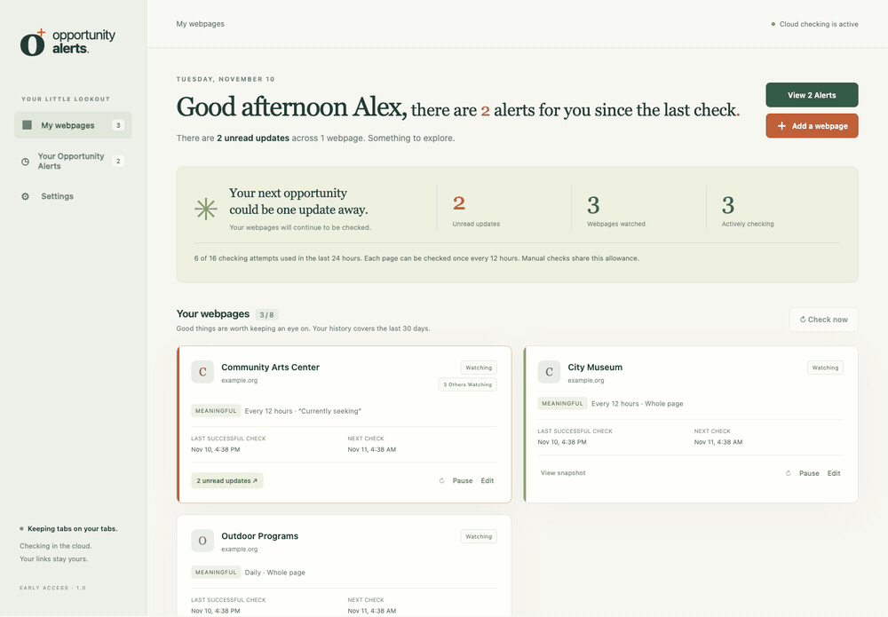
  <br />
  <sub>The actual interface, captured with fictional sample data. Screenshots and GIFs do not show a member’s private account or claim that a real webpage changed.</sub>
</p>


> This repository contains public information and sample images for Opportunity Alerts. The application source, production configuration, and member data are private.

Read the [project case study](CASE_STUDY.md) for the problem, product decisions, and implementation overview.

## Table of Contents

<details>
<summary>Open Table of Contents</summary>

<br />

- [Why This Project Was Created](#why-this-project-was-created)
- [About Opportunity Alerts](#about-opportunity-alerts)
- [Live Website and Early Access](#live-website-and-early-access)
- [How to Use Opportunity Alerts](#how-to-use-opportunity-alerts)
- [Meaningful Changes and All Changes](#meaningful-changes-and-all-changes)
- [Checking Limits and Scheduling](#checking-limits-and-scheduling)
- [Email Alerts](#email-alerts)
- [Privacy and Account Controls](#privacy-and-account-controls)
- [Mobile Browser Support](#mobile-browser-support)
- [Known Limitations](#known-limitations)
- [Screenshots and GIFs](#screenshots-and-gifs)
- [Project Case Study](#project-case-study)
- [Rights and Use](#rights-and-use)

</details>

## Why This Project Was Created

I created Opportunity Alerts because I was manually monitoring volunteer and job webpages, returning to the same links over and over to see whether anything had changed. I wanted something straightforward and accessible that could check those pages for me and send an email when there was something new.

The idea extends beyond job searches. Someone might want to volunteer more, join a board, get involved in their community, follow an artist’s next announcement, or keep an eye on camping information. When life is busy, remembering to check every page becomes another task. It is easy to miss an opportunity simply because you did not open a webpage at the right time.

I wanted the app to make that routine easier without using AI to compare webpages or send alerts. Opportunity Alerts saves a starting point, checks for content changes on a schedule, and shows what was added, removed, or updated in a readable way. The person using it decides which webpages matter and what to do with the information.

## About Opportunity Alerts

Opportunity Alerts is a fully hosted webpage monitor with a separate private dashboard for each member.

- **Saved webpages:** add, name, edit, pause, resume, and remove the public pages you want to watch.
- **Two comparison modes:** use Meaningful changes for main content or All changes for a broader view of the page.
- **Section monitoring:** select a heading to watch one part of a webpage instead of the entire page.
- **Readable changes:** review additions, removals, and Previously / Now comparisons without reading a code-style diff.
- **Page context:** new snapshots retain available headings, subheadings, body text, and page-region information. Older alerts without that structure use generic content labels.
- **Dashboard shortcuts:** an orange unread total and the numbered View Alerts button open Your Opportunity Alerts.
- **Alert cards:** one wide card per webpage, with its icon or letter fallback, check times, snapshot, and monitoring controls.
- **Read states:** orange marks unread alerts; green marks read history.
- **Email notifications:** opt in to short, branded emails that link back to your private dashboard.
- **Interests:** optionally share what opportunities you are hoping for, then update those choices in Settings.
- **Shared watching counts:** see an anonymous count of other active members watching the same webpage.
- **Account controls:** manage email preferences, export your data, sign out, or delete your account.

## Live Website and Early Access

```text
https://opportunityalerts.elichristmas.dev
```

Registration is currently limited to **30 verified members, including the developer**. Create an account with your name, email address, and password, then verify your email to finish joining while places remain. Existing members can continue signing in when registration is full.

Website users do not need Python, Node, Docker, Cloudflare credentials, SMTP settings, or a local backend. Those belong to development and hosting, not the sign-up process.

## How to Use Opportunity Alerts

### 1. Create Your Account

Open the website, choose **Create an account**, and enter your details. The form recommends a unique password of at least 15 characters and supports password managers. Confirm your email using the verification message.

The optional **What opportunities are you hoping for?** question includes job openings, volunteer positions, board positions, concerts, live events, community events, camping, and Other. Other includes a text field. Your choices and anything you type in the **Other** field are visible to the developer, as explained beside the question. You can change them at any time in Settings.

<p align="center">
  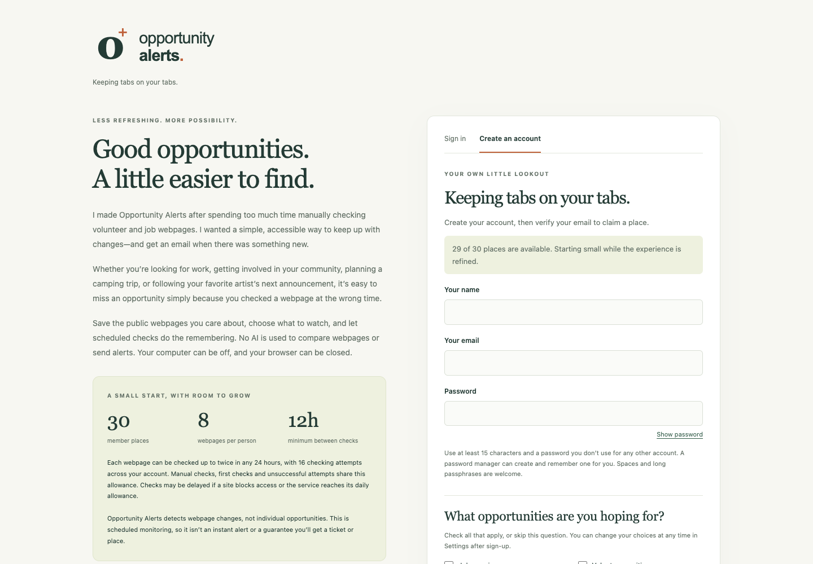
</p>

<details>
<summary>View the interests question</summary>

<br />

<p align="center">
  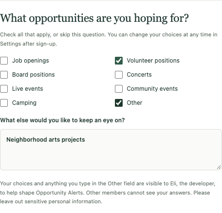
</p>

</details>

### 2. Add a Webpage

Choose **Add a webpage**, give it a name, paste its public URL, choose a comparison mode, and set its checking interval. The first successful check establishes a baseline; it does not create an alert.

After that first check, use the saved-content preview to review the monitored text and available headings. Choosing a particular heading limits monitoring to that section. The preview reuses saved content instead of requesting an extra check.

<p align="center">
  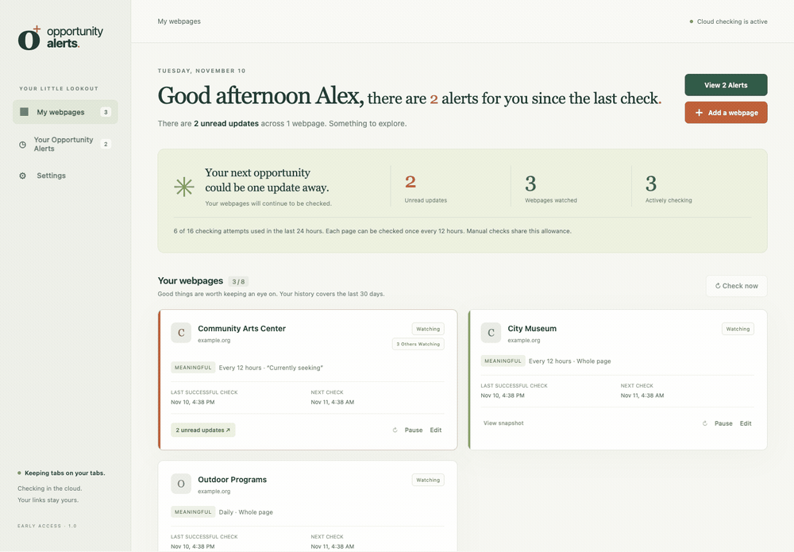
</p>

<details>
<summary>View the Add a webpage form</summary>

<br />

<p align="center">
  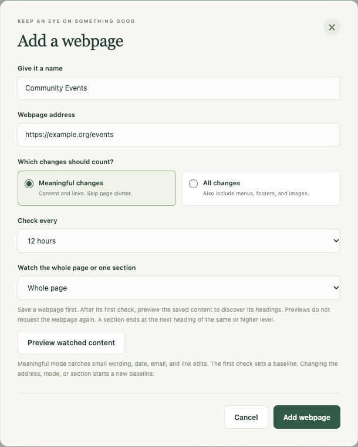
</p>

</details>

### 3. Follow Your Webpages from the Dashboard

The dashboard shows your watched pages, their status, unread alerts, and check times. Each entry uses the website’s icon when one is available, with a letter in the same square as a fallback.

When there are unread alerts, choose the **View Alerts** button above Add a webpage or click the orange unread number. The button shows the current count, such as **View 2 Alerts**. When there are none, the extra button disappears and Add a webpage returns to its original position.

<p align="center">
  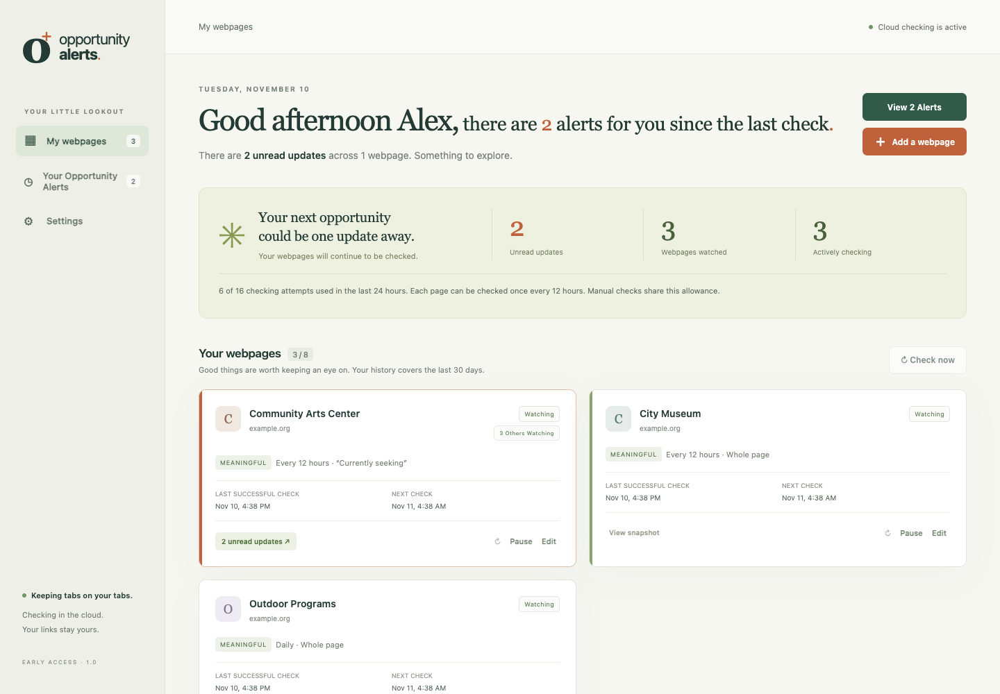
</p>

An **Others Watching** label counts other enabled members actively watching the same normalized full URL. It does not reveal their names, schedules, section selections, or saved content. Paused watches are excluded from that count.

### 4. Open Your Opportunity Alerts

Your Opportunity Alerts groups detected updates by webpage in a list of wide cards. Each card includes **Webpage changes found**, its unread/read state, last successful check, last check, next check, snapshot access, and monitoring controls.

Choose **View changes** for an individual alert. Updated content appears as **Previously** and **Now**; additions and removals are labeled directly. Where the saved structure is available, the view identifies headings, subheadings, body content, and page regions. Footer and navigation content are included only when the selected mode and scope watch them.

Mark an alert read individually, mark a webpage’s alerts read, or use the page-wide Mark all read control.

<p align="center">
  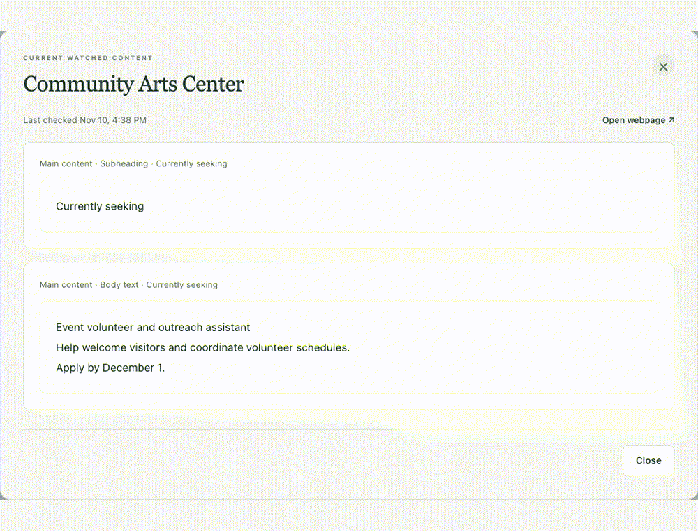
</p>

<details>
<summary>View the alert list and readable changes</summary>

<br />

<p align="center">
  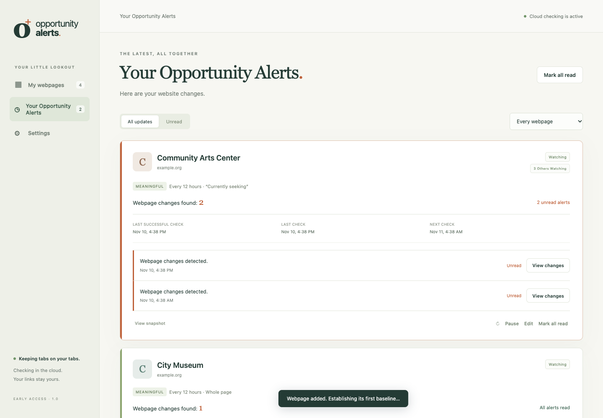
</p>

<p align="center">
  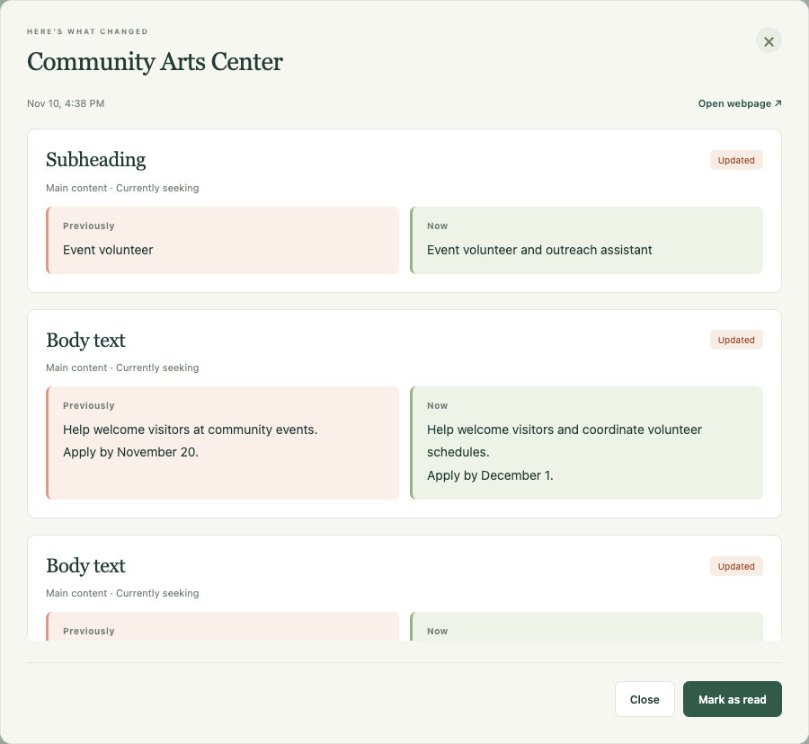
</p>

<p align="center">
  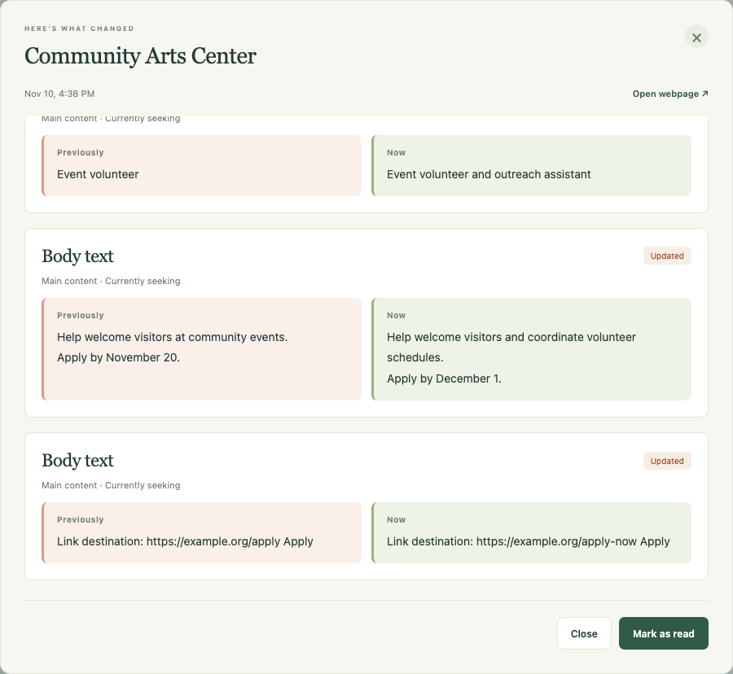
</p>

</details>

A detected update is a change between checks. Its count does not claim to identify a particular number of jobs, volunteer roles, tickets, or other opportunities.

### 5. Manage Email and Interests in Settings

Settings contains your display name, email-alert preference, interests, export, sign-out, and account-deletion controls. Your verified account email is the notification recipient.

The email switch reports whether alerts are on, off, or not saved yet. The test-email action shows whether a message is queued, accepted by the email service, failed, or uncertain. Provider acceptance is separate from arrival in your inbox.

<p align="center">
  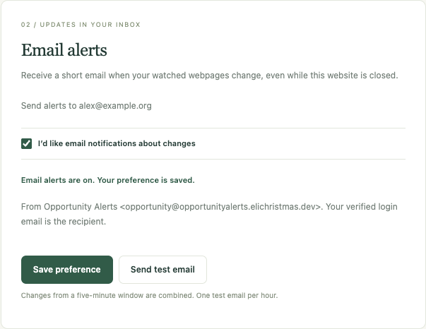
</p>

<details>
<summary>View interests in Settings</summary>

<br />

<p align="center">
  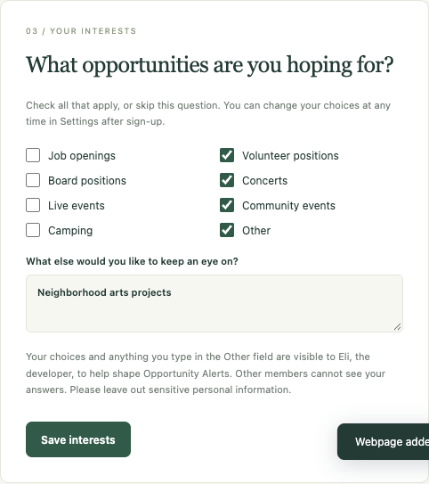
</p>

</details>

## Meaningful Changes and All Changes

| Mode | What is compared |
| --- | --- |
| **Meaningful changes** | Main content text and link destinations, excluding navigation, footer content, scripts, layout, and whitespace noise. Small date, email, wording, and application-link edits count. |
| **All changes** | Page text, link destinations, and image references, including navigation and footer content within the selected scope. |

All changes refers to content, not raw HTML, screenshots, pixel differences, or changing image bytes at an unchanged image URL.

A heading selection watches that heading’s section until the next heading of the same or higher level. If the section disappears, the app preserves the last valid snapshot and reports an error instead of treating the whole section as removed. Changing the address, mode, or section starts a fresh baseline without generating a change alert for that reset.

## Checking Limits and Scheduling

| Item | Current limit or behavior |
| --- | --- |
| Early access | 30 verified members, including the developer |
| Saved webpages | 8 per member, including paused watches |
| Default interval | 12 hours |
| Other intervals | Daily or a custom interval of at least 12 hours |
| Account checking allowance | 16 logical attempts in any rolling 24 hours |
| Per-webpage allowance | At least 12 hours between attempts |
| What consumes an attempt | First checks, manual checks, and failed fetches, as well as successful scheduled checks |
| Dashboard refresh | Does not request another monitored-page check |
| Missed schedules | One catch-up check per overdue page, rather than replaying every missed run |
| History | 30 days of updates plus the current baseline |
| Test email | At most once per hour per member |

Checking runs on the server, so closing a tab or turning off your computer does not stop it. A next-check time is a schedule, not a guaranteed exact delivery time: website rate limits, network failures, and service-wide safety allowances can defer work. The dashboard explains those states.

## Email Alerts

Email alerts are optional and are offered during sign-up and in Settings. Changes detected close together are combined into one message per member.

**Sender:** Opportunity Alerts &lt;opportunity@opportunityalerts.elichristmas.dev&gt;

Messages include the changed page names and a dashboard link. Detailed source content stays in the private dashboard. Initial baselines and unchanged pages do not send change notifications. Temporary sending failures use bounded retries; uncertain outcomes stop automatic retries to avoid repeatedly sending a message whose status is unknown.

<p align="center">
  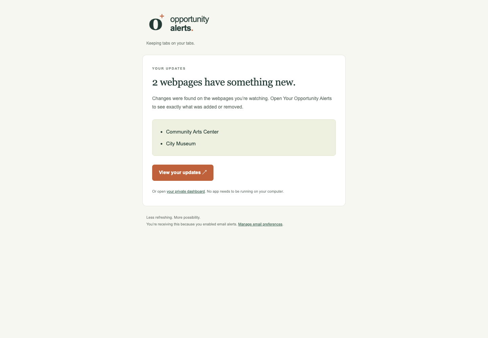
</p>

<p align="center"><sub>Rendered from the actual email template with fictional page names; this capture does not send an email.</sub></p>

## Privacy and Account Controls

- **Separate accounts:** private dashboards and API operations require an authenticated member and ownership checks.
- **Password handling:** Better Auth handles hashing, email verification, sessions, sign-out, and password recovery. Resetting a password revokes existing sessions.
- **No website credentials:** monitoring supports public pages and does not ask for logins to the websites you watch.
- **Optional interests:** the developer can review your selected categories and Other text. Other members cannot see those responses.
- **Anonymous shared counts:** members see only a count of others watching the same page.
- **Inert source content:** fetched webpage HTML is reduced to text and structural records; its scripts are not inserted into the dashboard.
- **Export and deletion:** export your saved data or delete your account in Settings. Deletion removes live data, credentials, sessions, and pending work. Provider recovery copies and private backups can retain deleted data for up to 30 days.
- **No advertising trackers:** the app does not include advertising trackers or third-party analytics SDKs.

The service needs to process watched URLs and public-page content to monitor them. Cloudflare hosts the application, database, checker, and email service. This is not end-to-end encryption. Service credentials and production configuration are kept private.

See [Security and privacy](SECURITY.md) for the public security overview.

## Mobile Browser Support

The same website adapts to smaller screens. Navigation, watched-page cards, the opportunity-alert list, readable changes, and settings remain available in a mobile browser.

<p align="center">
  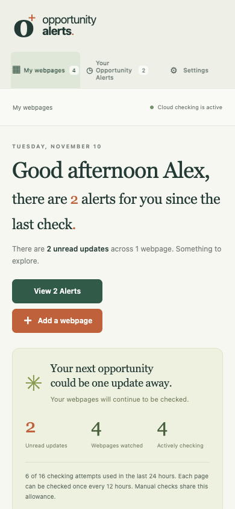
  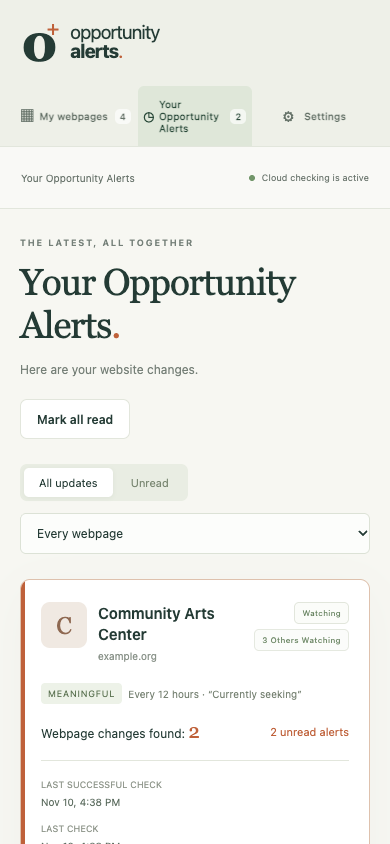
  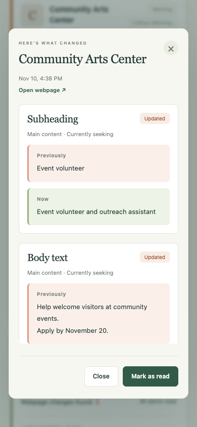
</p>

The current product is a website. A native iOS app and paid memberships are not part of this release.

## Known Limitations

- Public HTML webpages only. PDFs, authenticated pages, and content that requires browser-side JavaScript are not supported by the initial direct-fetch checker.
- Websites may block background requests, present human-verification challenges, or rate-limit access. Some pages cannot be monitored reliably, including those that require human-verification challenges.
- Checks run on a schedule. The app cannot guarantee that you will see a job, campsite, event, or ticket announcement immediately or secure a place before someone else.
- The app detects content changes; it does not decide whether a listing is relevant, still open, safe, or a good match for you.
- An edited email address or email link can be detected, but mailbox deliverability is not tested.
- Page structure varies. Older snapshots and content without useful structural metadata are displayed with generic content labels.
- The checking and email allowances are service limits, not a guarantee of zero hosting costs or exact delivery times.

## Screenshots and GIFs

The screenshots show the actual frontend and email template with fictional example pages, sample account details, and simulated updates. No real member account, password, verification link, private webpage, or mailbox was used to create them.

## Project Case Study

The [project case study](CASE_STUDY.md) covers the problem, my role, the main product and engineering decisions, and how the work was checked.

## Rights and Use

© 2026 mp3li. All rights reserved.

This repository shares information and sample images about Opportunity Alerts. It does not publish or license the application source code. The project name, logo, screenshots, GIFs, and written material are not offered under an open license. GitHub's Terms of Service and applicable law still apply.
